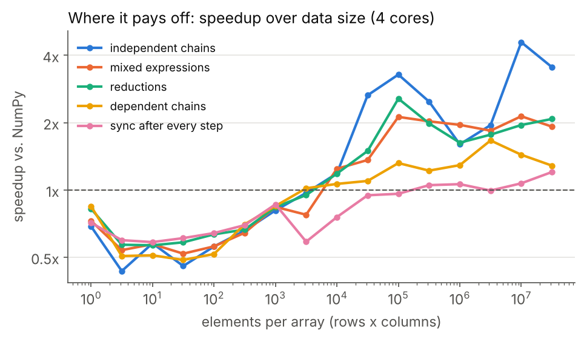

# viproc

**viproc runs NumPy programs faster. No annotations. Bit-equal results. Single node strong scaling.**

viproc, a **vi**rtual **proc**essor for numerical programs, runs the array instructions of an
ordinary, sequential NumPy program in parallel wherever their data dependencies allow it.

```python
c = np.sin(a) * b     # issued, returns at once
d = np.cos(b) - a     # does not need c: runs at the same time
s = (c + d).sum()     # starts as soon as c and d are done
print(s)              # only here does the program wait
```

```bash
pip install git+https://github.com/hokb/viproc
python -m viproc prog.py          # your unchanged NumPy program, now in parallel
```

## Why viproc

- **No code changes.** Run an existing program with `python -m viproc prog.py`, or write
  `import viproc as np`. No annotations, no rewrite, no ahead-of-time analysis.
- **Bit-identical to NumPy.** Every instruction is computed by the installed NumPy's own
  kernels (SIMD included), called exactly as NumPy calls them: same values, dtypes, shapes,
  strides, warnings and errors. What viproc cannot run asynchronously falls back to NumPy.
- **Parallel where manual parallelization cannot be.** Decisions are made per array
  operation, so independent work overlaps across loop iterations, function calls and
  modules, even in a loop whose iterations depend on their order (a `Parallel.For` gives
  wrong results there; viproc keeps the order where it matters).
- **Complexity becomes performance.** A single operation does not get faster, but real
  programs are not single operations: the more a program does, the more of its array
  instructions are independent, and viproc turns that into parallel execution.
- **No central scheduler, no dependency graph.** Each instruction runs as soon as its
  inputs are ready, on whichever core is free; the Python thread only issues instructions
  and runs ahead.

## Benchmarks

All results bit-identical to NumPy; speedup = NumPy time / viproc time.


ILNumerics' array-pipelining demo (`python/benchmarks/array_pipelining.py`): a Python loop
over the columns of a 1,500 x 1,500 matrix, nothing annotated. A thread pool makes NumPy
slower (the GIL) and the order-dependent variant wrong; viproc overlaps the iterations.


Whole programs on 4 cores, from independent chains to k-means, FFT pipelines and
simulations. A strictly dependent chain (logistic regression) has nothing to overlap.



Shape map: 19 programs over 1 to 5 x 10^7 elements per array, 4 cores (2026-10-15).
viproc pays off from ~10,000 elements; below that, the per-operation overhead on top of
NumPy shows (work in progress, see [goals](docs/design/goals.md)).

Suite scores, all shape maps, other machines and how to measure:
[docs/benchmarks.md](docs/benchmarks.md). Chart data: `docs/benchmarks/readme/make_charts.py`.

## Quick start

Requirements: 64-bit Python >= 3.12, NumPy >= 2.5 and, until there are prebuilt wheels, a
C++20 compiler (Visual Studio with the C++ workload on Windows, GCC or Clang on Linux). pip
builds the extension in about a minute.

```bash
pip install git+https://github.com/hokb/viproc     # or: git clone ...; pip install .
```

Three ways to use it:

```bash
python -m viproc prog.py [args]     # 1. no code change (also -m module, -c "code")
VIPROC=1 python prog.py             #    the same, through an environment variable
```

```python
import viproc as np                 # 2. one line changed

x = np.random.default_rng(0).standard_normal((2000, 2000))
y = np.sin(x) * np.cos(x)           # returns immediately, computed in the background
print(float(y.sum()))               # sync point
```

```python
import numpy as np                  # 3. keep NumPy, convert selected arrays
import viproc

a = viproc.asarray(np.random.rand(1_000_000))
c = np.sin(a) * 2.0 + 1.0           # NumPy functions on viproc arrays run in viproc
```

Compare with plain NumPy: `python prog.py` vs. `python -m viproc prog.py`, or inside one run
`with viproc.disabled(): ...`. Installed libraries (SciPy, pandas, ...) keep the real NumPy
and read viproc arrays through NumPy's array protocols.

Testing viproc on your own code, IDE setup (PyCharm, VS Code, Spyder, Jupyter) and the known
differences from NumPy: [docs/testing.md](docs/testing.md).

## How it works

- **One task per array instruction** (`a + b`, `np.sin(x)`, `x.sum(axis=0)`, `x[idx]`,
  `a @ b`, ...). viproc overlaps whole instructions, as a superscalar CPU overlaps machine
  instructions; it does not split single operations.
- **The Python thread runs ahead.** It issues instructions and returns at once; up to 1,000
  of them are in flight. By the time early results complete, later instructions are already
  waiting for exactly their inputs.
- **Local decisions only.** An array is `ready` or `pending`; a task starts when its inputs
  are ready, on the thread that finished the last one. Writes after reads stay correct via
  per-buffer read counters and copy-on-write.
- **Sync points** are where values are read: `print(x)`, `float(s)`, `if (x > 0).any():`.
  Only these make the Python thread wait, for that one result.
- **Kernels are NumPy's.** Ufunc loops, reductions, matmul, linalg, FFT and sort are taken
  from the installed NumPy at run time and called without the GIL on worker threads.

The model follows the [ILNumerics Accelerator](https://ilnumerics.net/auto-parallelizing-numerical-code.html),
described in the paper [*A Virtual Processor brings back the Free Lunch*](https://arxiv.org/abs/2605.30507)
(2026; artifacts: [decentralized-array-execution-artifacts2026](https://github.com/hokb/decentralized-array-execution-artifacts2026)).

## Status

- **Phase 1: multi-core CPUs, optimization level O1** (array ILP only, bit-identical).
  Element-wise ufuncs, reductions, indexing, `np.where`, matmul/dot, most of `numpy.linalg`
  and `numpy.fft`, sort and many composed functions run asynchronously; the rest falls back
  to NumPy.
- **Goal:** every program at 0.8x of NumPy or faster, complex programs clearly faster. Small
  arrays (below ~10,000 elements) and programs that read a result after nearly every step
  are not there yet.
- **Planned levels**, each correct but no longer bit-identical: O2 stage pipelining and
  viproc-owned BLAS threading, O3 own and fused kernels, O4 automatic device offloading
  (GPUs). O1 stays available.

## Documentation

| | |
|---|---|
| [docs/design/goals.md](docs/design/goals.md) | goals, non-goals, optimization levels, roadmap |
| [docs/benchmarks.md](docs/benchmarks.md) | all measurements, per change and per machine |
| [docs/testing.md](docs/testing.md) | trying viproc on your own code, IDEs, known differences |
| [docs/design/](docs/design/) | memory management, error handling, data model, pipelining |
| [docs/optimizations.md](docs/optimizations.md) | every optimization: done, open, rejected |
| [CLAUDE.md](CLAUDE.md) | architecture and implementation details |
| [docker/README.md](docker/README.md) | Linux, Windows and Wine images |

## Development

```bash
./dev.sh                     # Linux: pull, build into .venv, run the tests (dev.cmd on Windows)
cmake -S . -B build -G Ninja && cmake --build build
ctest --test-dir build --output-on-failure            # needs: pip install pytest
PYTHONPATH=build/python python3 python/benchmarks/suite.py   # benchmark suite
```
