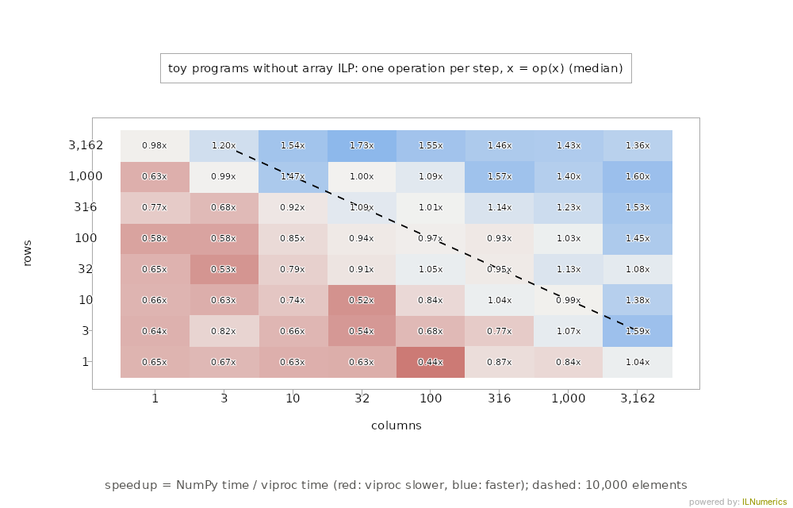
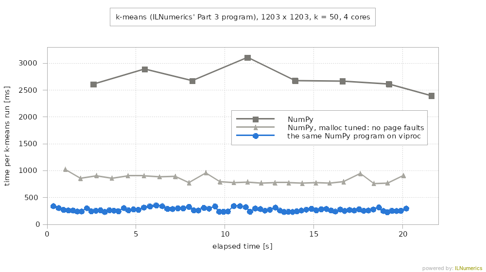
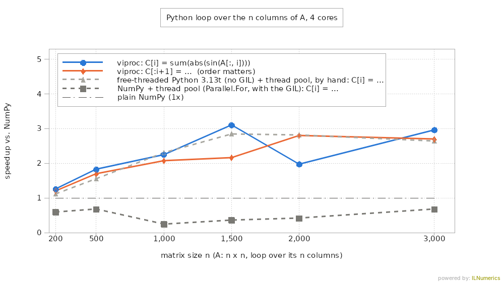
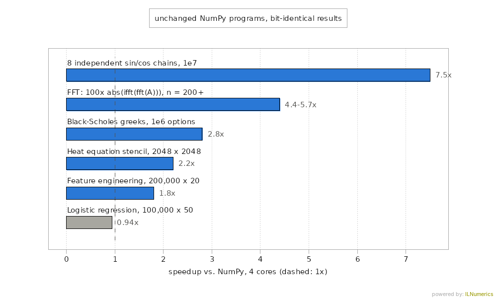

# viproc

**viproc runs NumPy programs faster. No annotations. Bit-equal results. Single node strong scaling.**

viproc, a **vi**rtual **proc**essor for numerical programs, runs the array instructions of an
ordinary, sequential NumPy program in parallel wherever their data dependencies allow it.

```python
c = np.sin(a) * b     # issued, returns at once
d = np.cos(b) - a     # does not need c: runs at the same time
s = (c + d).sum()     # starts as soon as c and d are done
print(s)              # only here does the program wait
```

```bash
pip install git+https://github.com/hokb/viproc
python -m viproc prog.py          # your unchanged NumPy program, now in parallel
```

## Why viproc

- **No code changes.** Run an existing program with `python -m viproc prog.py`, or write
  `import viproc as np`. No annotations, no rewrite, no ahead-of-time analysis.
- **Bit-identical to NumPy.** Every instruction is computed by the installed NumPy's own
  kernels (SIMD included), called exactly as NumPy calls them: same values, dtypes, shapes,
  strides, warnings and errors. What viproc cannot run asynchronously falls back to NumPy.
- **Parallel where manual parallelization cannot be.** Decisions are made per array
  operation, so independent work overlaps across loop iterations, function calls and
  modules, even in a loop whose iterations depend on their order (a `Parallel.For` gives
  wrong results there; viproc keeps the order where it matters).
- **Complexity becomes performance.** A single operation does not get faster, but real
  programs are not single operations: the more a program does, the more of its array
  instructions are independent, and viproc turns that into parallel execution.
- **No central scheduler, no dependency graph.** Each instruction runs as soon as its
  inputs are ready, on whichever core is free; the Python thread only issues instructions
  and runs ahead.

## Benchmarks

All measurements on 4 cores (Linux VM), all results bit-identical to NumPy; speedup = NumPy
time / viproc time. Figures drawn with [ILNumerics](https://ilnumerics.net).

### A toy program: one operation per step



The worst case for viproc: a program that does one operation per step (`x = op(x)`), so
there is no array ILP to find. The map shows the median speedup of such toy programs over
array shapes. From ~10,000 elements (dashed line) they run at 0.93-1.73x; below that viproc
is slightly slower than NumPy (median 0.75x), because each operation pays the asynchronous
layer (task, dispatch) on top of NumPy's own call and has nothing to overlap with. Reducing
this overhead is on the roadmap.

*How to read it:* each cell is one array shape (rows x columns, logarithmic steps); its
number is the median speedup of the single-operation cases at that shape. Blue cells are
faster than NumPy, red ones slower, light gray ones about equal. Shapes above the dashed line
have more than 10,000 elements.

### Real programs

Real programs are not single operations: the more a program does, the more of its array
instructions are independent. viproc uses that automatically, and it hides the overhead.



**A whole algorithm: k-means.** ILNumerics' k-means program (Part 3 of the
[paper's artifacts](https://github.com/hokb/decentralized-array-execution-artifacts2026)),
the unchanged NumPy script run with `python -m viproc`: 265 ms per run, 3.0x faster than
NumPy with its temporaries' page faults tuned away (789 ms; 2,670 ms with glibc's defaults on
this VM, where every 481 KB temporary is mapped fresh). Same clusters, same iterations.

*How to read it:* this is ILNumerics' way of measuring. The program runs again and again for
about 20 seconds. Each marker is one complete k-means run: it sits at the time since the
program started when the run finished (x) and shows how long that run took (y). So a line
shows how the program's speed develops while it runs. The first runs include warm-up (one-time
setup, caches filling); after that the line is flat at the program's steady speed. Lower is
faster, and more markers in the same 20 seconds mean more runs done: 73 on viproc, 24 on the
tuned NumPy, 8 on NumPy with glibc's defaults. viproc's first run took 340 ms, and from the
fourth run on it stays near 250 ms.



**A plain Python loop, parallel without changes.** ILNumerics' loop demo in NumPy
(`python/benchmarks/array_pipelining.py`): `C[i] = sum(abs(sin(A[:, i])))` over the columns
of A. viproc runs it unchanged at 1.2x (200 x 200) to 3.1x, and also the variant whose
iterations overwrite earlier results (`C[:i+1] = ...`), where the order matters. The manual
way, a thread pool over the columns (`Parallel.For`), makes NumPy slower under the GIL.
Free-threaded Python 3.13t (no GIL) makes the thread pool fast (1.1-2.8x vs. NumPy on that
interpreter), but it has to be written by hand and gives wrong results for `C[:i+1] = ...`.

*How to read it:* x is the size of the matrix (n x n, so the loop runs n times on columns of
n elements); y is the speedup over the plain NumPy loop on one core. The dash-dotted line at
1x is plain NumPy: lines above it are faster, lines below it slower. Solid lines are viproc,
dashed lines the manual thread pools.



**More programs:** independent chains, an FFT pipeline, finance, a stencil and
preprocessing gain 1.8-7.5x; a strictly dependent chain (logistic regression) has nothing to
overlap. Each bar is one program; its length is the speedup over NumPy, and the dashed line
marks 1x (as fast as NumPy).

Suite scores, all shape maps, other machines and how to measure:
[docs/benchmarks.md](docs/benchmarks.md). Figure data and scripts: `docs/benchmarks/readme/`.

## Quick start

Requirements: 64-bit Python >= 3.12, NumPy >= 2.5 and, until there are prebuilt wheels, a
C++20 compiler (Visual Studio with the C++ workload on Windows, GCC or Clang on Linux). pip
builds the extension in about a minute.

```bash
pip install git+https://github.com/hokb/viproc     # or: git clone ...; pip install .
```

Three ways to use it:

```bash
python -m viproc prog.py [args]     # 1. no code change (also -m module, -c "code")
VIPROC=1 python prog.py             #    the same, through an environment variable
```

```python
import viproc as np                 # 2. one line changed

x = np.random.default_rng(0).standard_normal((1000, 1000))
y = np.sin(x) * np.cos(x)           # returns immediately, computed in the background
print(float(y.sum()))               # sync point
```

```python
import numpy as np                  # 3. keep NumPy, convert selected arrays
import viproc

a = viproc.asarray(np.random.rand(1_000_000))
c = np.sin(a) * 2.0 + 1.0           # NumPy functions on viproc arrays run in viproc
```

Compare with plain NumPy: `python prog.py` vs. `python -m viproc prog.py`, or inside one run
`with viproc.disabled(): ...`. Installed libraries (SciPy, pandas, ...) keep the real NumPy
and read viproc arrays through NumPy's array protocols.

Testing viproc on your own code, IDE setup (PyCharm, VS Code, Spyder, Jupyter) and the known
differences from NumPy: [docs/testing.md](docs/testing.md).

## How it works

- **One task per array instruction** (`a + b`, `np.sin(x)`, `x.sum(axis=0)`, `x[idx]`,
  `a @ b`, ...). viproc overlaps whole instructions, as a superscalar CPU overlaps machine
  instructions; it does not split single operations.
- **The Python thread runs ahead.** It issues instructions and returns at once; up to 1,000
  of them are in flight. By the time early results complete, later instructions are already
  waiting for exactly their inputs.
- **Local decisions only.** An array is `ready` or `pending`; a task starts when its inputs
  are ready, on the thread that finished the last one. Writes after reads stay correct via
  per-buffer read counters and copy-on-write.
- **Sync points** are where values are read: `print(x)`, `float(s)`, `if (x > 0).any():`.
  Only these make the Python thread wait, for that one result.
- **Kernels are NumPy's.** Ufunc loops, reductions, matmul, linalg, FFT and sort are taken
  from the installed NumPy at run time and called without the GIL on worker threads.

The model follows the [ILNumerics Accelerator](https://ilnumerics.net/auto-parallelizing-numerical-code.html),
described in the paper [*A Virtual Processor brings back the Free Lunch*](https://arxiv.org/abs/2605.30507)
(2026; artifacts: [decentralized-array-execution-artifacts2026](https://github.com/hokb/decentralized-array-execution-artifacts2026)).

## Status

- **Phase 1: multi-core CPUs, optimization level O1** (array ILP only, bit-identical; BLAS
  threads are chosen per call: OpenBLAS's own count for a product alone, one thread while other
  work runs, so large matrix products match NumPy with the thread count they ran with;
  `VIPROC_BLAS_THREADS=1` fixes one thread).
  Element-wise ufuncs, reductions, indexing, `np.where`, matmul/dot, most of `numpy.linalg`
  and `numpy.fft`, sort and many composed functions run asynchronously; the rest falls back
  to NumPy.
- **Goal:** every program at 0.8x of NumPy or faster, complex programs clearly faster. From
  ~1,000 elements per array the shape map's programs are there (median 0.93x and up); on
  tiny arrays the median is 0.63-0.96x, single operations down to 0.44x: the per-operation
  overhead is being worked down.
- **Planned levels**, each correct and faster but no longer bit-identical: O2 stage pipelining, O3 own and fused kernels, O4 automatic device offloading
  (GPUs). O1 stays available.

## Documentation

| | |
|---|---|
| [docs/design/goals.md](docs/design/goals.md) | goals, non-goals, optimization levels, roadmap |
| [docs/benchmarks.md](docs/benchmarks.md) | all measurements, per change and per machine |
| [docs/testing.md](docs/testing.md) | trying viproc on your own code, IDEs, known differences |
| [docs/design/](docs/design/) | memory management, error handling, data model, pipelining |
| [docs/optimizations.md](docs/optimizations.md) | every optimization: done, open, rejected |
| [CLAUDE.md](CLAUDE.md) | architecture and implementation details |
| [docker/README.md](docker/README.md) | Linux, Windows and Wine images |

## Development

To work on viproc itself, build it from a checkout and run its tests:

```bash
./dev.sh          # Linux; dev.cmd on Windows: git pull, build into .venv, run all tests
.venv/bin/python -m viproc prog.py      # try the build (Windows: .venv\Scripts\python)
```

CMake builds, the benchmark suite and the Docker images: [CLAUDE.md](CLAUDE.md), "Commands".
