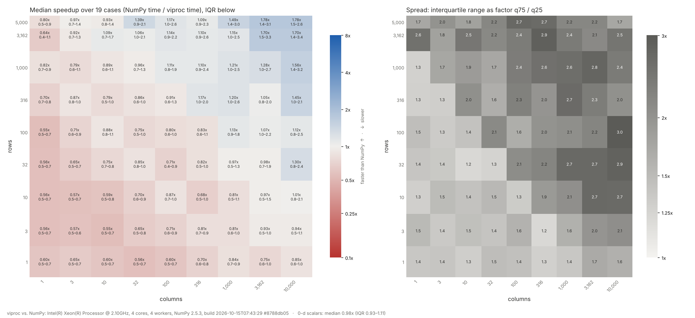
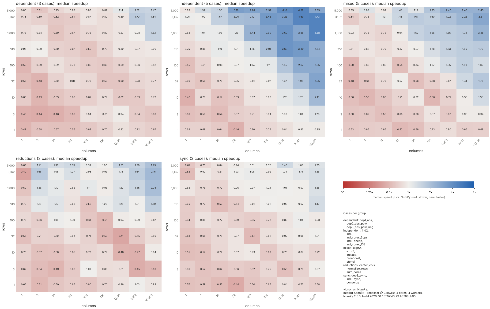
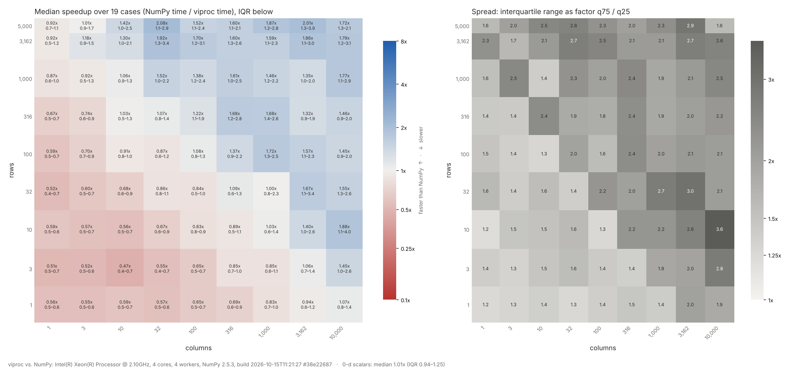
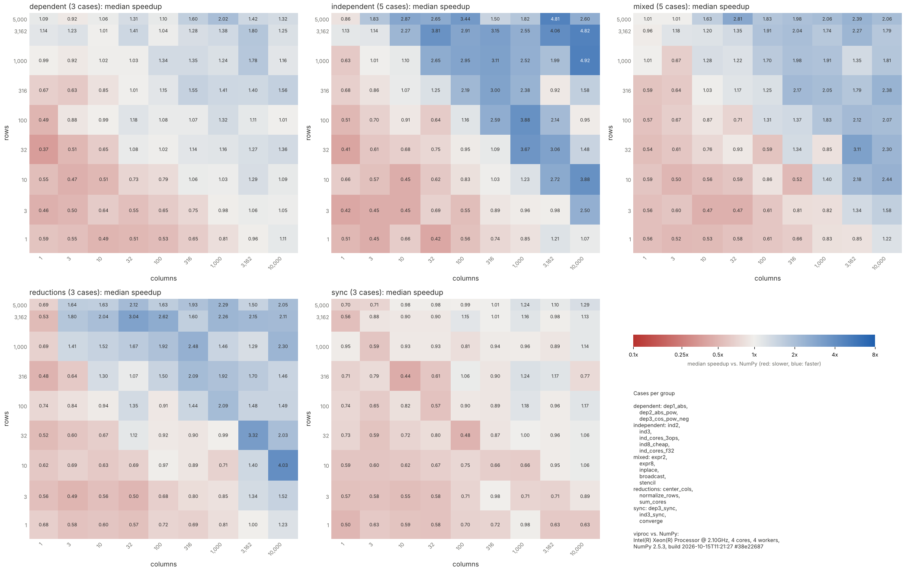
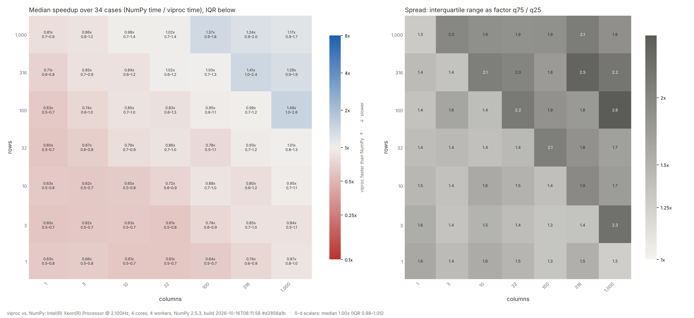
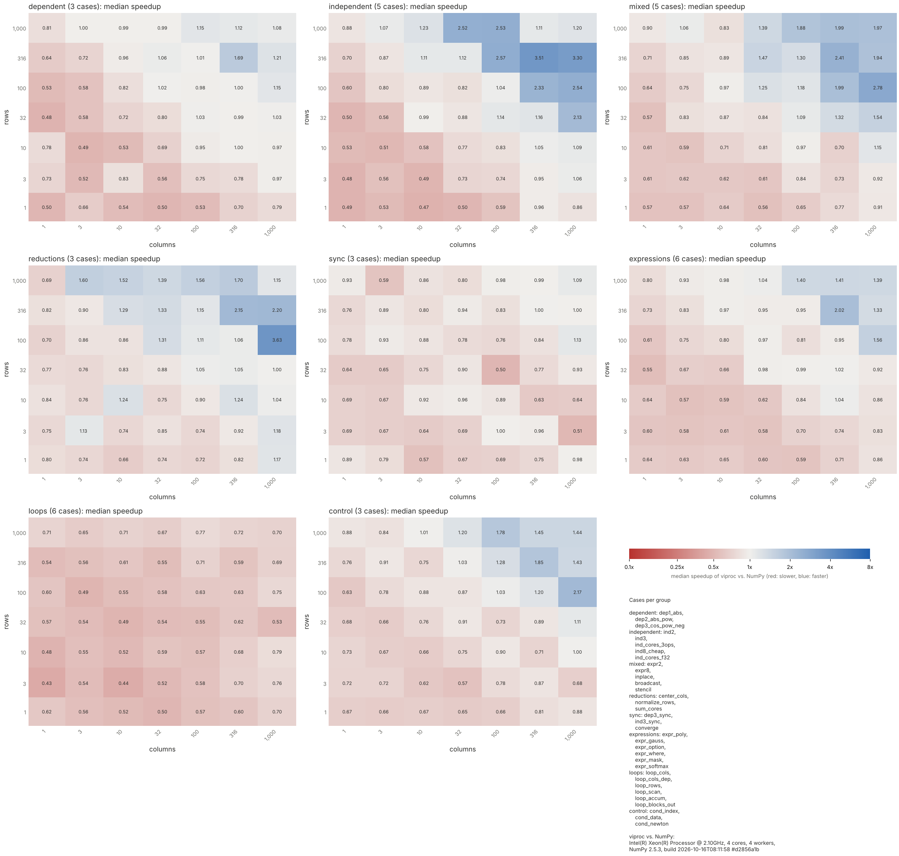

# Benchmarks

Results of viproc's benchmarks over its development: the current
breakdown, the progress per change and runs on other machines. Update
this file with every change that is judged by a benchmark (see "Adding a
run" at the end).

## How to measure

- **Benchmark suite** (`python/benchmarks/suite.py`): ~100 configurations
  of plain NumPy programs, each run as NumPy and on viproc with 1 worker
  and with one worker per core; every result must be bit-identical.
  efficiency = speedup vs. NumPy / ideal; ideal = min(cores, P) for
  medium and large data (P: the program's independent instruction
  streams), 1 (parity) for scalar, tiny and small data. Score = 100 x
  geomean over categories of geomean(efficiency). 100 = ideal scaling on
  the machine; above 100 is possible (e.g. viproc's element pool avoids
  page faults NumPy pays for its temporaries).
- Sizes: scalar (0-d), tiny (8 elements), small (1,000), medium
  (100,000), large (RAM per core, ~3-4 million elements on these
  machines).
- `docker/benchmark.sh` / `docker\benchmark.ps1`: the suite on Linux and on
  the Windows build (Wine), with a comparison report.
- Micro benchmarks: `strong_scaling.py` (independent sin/cos chains),
  `sync_latency.py` (issue an op, read the result right away), callgrind
  instruction counts per op (Release, `OPENBLAS_NUM_THREADS=1`).
- **Where results go.** Local runs write to `./reports` (gitignored;
  `bench_win/` is ignored too), so `git pull` never conflicts with them.
  The scripts refuse an `--out` directory that holds files tracked by git;
  committed reference results (`docs/benchmarks/`, e.g.
  `docs/benchmarks/windows/`: shape maps of viproc and ILNumerics on the
  i7-12700K, Windows) are replaced only on purpose, with `--reference`.

**Comparability.** Compare scores only between runs on the same machine
and with the same options. The cloud VM of the development sessions
changed between runs (Xeon @ 2.10 GHz until 2026-10-13, @ 2.80 GHz since):
NumPy itself got up to 2.5x faster in some cases, which moves
efficiencies by more than most changes. `--quick` runs are noisier and
not comparable to full runs. Each report names its build (`build <time>
#<fingerprint>`); check it before comparing (stale reports cost a day in
this phase).

## Current results

Full run, 2026-10-14, commit `a40aec8` (code of `5db8972`), build
`2026-10-13T19:37:44 #2ba0f304`; Linux, Intel Xeon @ 2.80 GHz, 4 cores,
15.7 GiB, Python 3.13.16, NumPy 2.5.3, Release build.

| | |
|---|---|
| **score** | **64** |
| speedup vs. NumPy, 4 workers (geomean) | 1.62x |
| speedup vs. NumPy, 1 worker (overhead) | 0.87x |
| bit-identical to NumPy | 100 / 100 |

| category | score | | size class | score |
|---|---:|---|---|---:|
| chains | 85 | | scalar | 96 |
| indexing | 49 | | tiny | 62 |
| reductions | 78 | | small | 72 |
| algorithms | 55 | | medium | 48 |
| dtypes | 53 | | large | 79 |
| scalars | 71 | | | |

Category x size (score of the configurations in the cell):

| | scalar | tiny | small | medium | large |
|---|---:|---:|---:|---:|---:|
| chains | 99 | 63 | 90 | 79 | 91 |
| indexing | | | 56 | 36 | 67 |
| reductions | | | 71 | 71 | 93 |
| algorithms | | | 55 | 42 | 88 |
| dtypes | | | 95 | 39 | 65 |
| scalars | 93 | 62 | | | |

### Reading the breakdown

- **Large data scales.** Element-wise chains, reductions, stencils and
  the algorithm kernels reach 4-7x on 4 cores (`dtype_chains` complex128
  6.9x, `black_scholes` 6.2x, `stencil_1d` 5.8x, `chains_wide` 4.7x,
  `softmax_rows` 4.2x). Above the ideal of 4: viproc's element pool and
  temporary elision avoid the page faults of NumPy's fresh temporaries.
- **Medium data (100,000 elements) is the weak class (48).** An op takes
  only ~50-100 µs there, so per-op costs and synchronisation weigh more:
  - indexing 36: `boolean_mask` 0.65x (a read through a mask syncs on the
    mask for its size), `scatter` 0.75x, `gather` 1.35x;
  - dtypes 39: int16 and float16 are not viproc dtypes (they stay NumPy
    arrays, efficiency 0.25 = parity), `dtype_promote` with them falls
    back (312 / 132 fallbacks);
  - algorithms 42: `kmeans_points` 0.67x (one `nonzero` sync per cluster
    and round, counted as fallbacks), `matmul_batch` 0.95x (`matmul` is
    still an eager fallback), `kmeans` 1.2x.
- **Small and tiny data: overhead only, ideal is parity.** Element-wise
  programs are at 0.6-1.0x (direct path; `x * y` on 8 elements costs
  0.63 µs vs. NumPy's 0.35 µs). Outliers: `matmul_batch` small 0.32x
  (7,052 fallbacks), `kmeans_points` small 0.32x and `kmeans` small 0.36x
  (syncs per cluster), `gather` small 0.44x (index parsing in Python,
  3-10 µs per op), `boolean_mask` small 0.51x.
- **Scalars are at NumPy's level** (scalar class 96): ops on scalars run
  as NumPy scalar math, `chain_serial` scalar 0.99x.
- Remaining fallbacks: `matmul` (gufunc), int16/float16 and the
  data-dependent `nonzero` in `kmeans_points` (by design).

### All configurations

| case | size | layout | dtype | P | NumPy ms | viproc w=1 ms | viproc w=4 ms | speedup | ideal | eff. | fallbacks |
|---|---|---|---|---:|---:|---:|---:|---:|---:|---:|---:|
| **chains** | | | | | | | | | | | |
| chains_wide | small | vec | float64 | 4 | 36.25 | 39.31 | 39.15 | 0.93x | 1x | 0.93 | 0 |
| chains_wide | medium | vec | float64 | 4 | 10.45 | 10.99 | 4.11 | 2.54x | 4x | 0.64 | 0 |
| chains_wide | medium | C | float64 | 4 | 24.03 | 35.30 | 6.64 | 3.62x | 4x | 0.90 | 0 |
| chains_wide | medium | F | float64 | 4 | 31.11 | 24.87 | 8.64 | 3.60x | 4x | 0.90 | 0 |
| chains_wide | medium | strided | float64 | 4 | 22.75 | 24.81 | 9.13 | 2.49x | 4x | 0.62 | 0 |
| chains_wide | large | vec | float64 | 4 | 760.51 | 452.13 | 162.49 | 4.68x | 4x | 1.17 | 0 |
| chains_wide | large | C | float64 | 4 | 509.89 | 471.13 | 146.95 | 3.47x | 4x | 0.87 | 0 |
| chains_8 | medium | vec | float64 | 8 | 28.39 | 34.27 | 10.03 | 2.83x | 4x | 0.71 | 0 |
| chains_8 | large | vec | float64 | 8 | 316.47 | 229.52 | 78.93 | 4.01x | 4x | 1.00 | 0 |
| chain_serial | scalar | scalar | float64 | 1 | 26.60 | 26.20 | 26.82 | 0.99x | 1x | 0.99 | 0 |
| chain_serial | tiny | vec | float64 | 1 | 24.60 | 37.87 | 39.31 | 0.63x | 1x | 0.63 | 0 |
| chain_serial | small | vec | float64 | 1 | 40.87 | 52.66 | 50.09 | 0.82x | 1x | 0.82 | 0 |
| chain_serial | medium | vec | float64 | 1 | 44.91 | 46.63 | 46.97 | 0.96x | 1x | 0.96 | 0 |
| chain_serial | large | vec | float64 | 1 | 31.24 | 19.85 | 19.71 | 1.58x | 1x | 1.58 | 0 |
| expression_tree | small | vec | float64 | 8 | 38.07 | 40.35 | 38.41 | 0.99x | 1x | 0.99 | 0 |
| expression_tree | medium | vec | float64 | 8 | 39.47 | 38.51 | 11.02 | 3.58x | 4x | 0.90 | 0 |
| expression_tree | large | vec | float64 | 8 | 367.48 | 265.35 | 131.85 | 2.79x | 4x | 0.70 | 0 |
| inplace_updates | small | vec | float64 | 4 | 39.92 | 51.19 | 51.04 | 0.78x | 1x | 0.78 | 0 |
| inplace_updates | medium | vec | float64 | 4 | 37.35 | 32.93 | 9.20 | 4.06x | 4x | 1.01 | 0 |
| inplace_updates | large | vec | float64 | 4 | 71.71 | 107.10 | 32.00 | 2.24x | 4x | 0.56 | 0 |
| dtype_mix | medium | vec | mixed | 4 | 35.87 | 29.09 | 13.59 | 2.64x | 4x | 0.66 | 0 |
| dtype_mix | large | vec | mixed | 4 | 85.06 | 57.73 | 26.24 | 3.24x | 4x | 0.81 | 0 |
| broadcast_outer | small | col | float64 | 4 | 35.68 | 34.78 | 34.96 | 1.02x | 1x | 1.02 | 0 |
| broadcast_outer | medium | col | float64 | 4 | 38.53 | 35.89 | 12.85 | 3.00x | 4x | 0.75 | 0 |
| **indexing** | | | | | | | | | | | |
| stencil_1d | small | vec | float64 | 4 | 22.11 | 28.11 | 28.26 | 0.78x | 1x | 0.78 | 0 |
| stencil_1d | medium | vec | float64 | 4 | 37.22 | 49.70 | 14.26 | 2.61x | 4x | 0.65 | 0 |
| stencil_1d | large | vec | float64 | 4 | 274.64 | 166.40 | 47.23 | 5.81x | 4x | 1.45 | 0 |
| stencil_2d | medium | C | float64 | 4 | 37.04 | 60.95 | 22.60 | 1.64x | 4x | 0.41 | 0 |
| stencil_2d | medium | F | float64 | 4 | 35.94 | 65.04 | 19.67 | 1.83x | 4x | 0.46 | 0 |
| stencil_2d | large | C | float64 | 4 | 203.17 | 214.19 | 75.62 | 2.69x | 4x | 0.67 | 0 |
| strided_views | medium | vec | float64 | 4 | 35.43 | 37.19 | 14.74 | 2.40x | 4x | 0.60 | 0 |
| strided_views | large | vec | float64 | 4 | 83.66 | 68.27 | 26.57 | 3.15x | 4x | 0.79 | 0 |
| gather | small | vec | float64 | 4 | 39.31 | 90.79 | 89.99 | 0.44x | 1x | 0.44 | 0 |
| gather | medium | vec | float64 | 4 | 23.97 | 43.30 | 17.75 | 1.35x | 4x | 0.34 | 0 |
| gather | large | vec | float64 | 4 | 303.89 | 484.89 | 131.36 | 2.31x | 4x | 0.58 | 0 |
| boolean_mask | small | vec | float64 | 4 | 36.23 | 71.52 | 71.04 | 0.51x | 1x | 0.51 | 0 |
| boolean_mask | medium | vec | float64 | 4 | 33.63 | 50.15 | 51.83 | 0.65x | 4x | 0.16 | 0 |
| boolean_mask | large | vec | float64 | 4 | 276.33 | 289.34 | 204.09 | 1.35x | 4x | 0.34 | 0 |
| scatter | medium | vec | float64 | 4 | 24.26 | 77.47 | 32.30 | 0.75x | 4x | 0.19 | 0 |
| scatter | large | vec | float64 | 4 | 164.42 | 232.55 | 65.54 | 2.51x | 4x | 0.63 | 0 |
| **reductions** | | | | | | | | | | | |
| reduce_full | small | vec | float64 | 4 | 34.72 | 58.81 | 51.24 | 0.68x | 1x | 0.68 | 0 |
| reduce_full | medium | vec | float64 | 4 | 40.59 | 37.97 | 10.57 | 3.84x | 4x | 0.96 | 0 |
| reduce_full | large | vec | float64 | 4 | 271.81 | 259.89 | 67.57 | 4.02x | 4x | 1.01 | 0 |
| reduce_axis | medium | C | float64 | 4 | 43.48 | 49.44 | 16.37 | 2.66x | 4x | 0.66 | 0 |
| reduce_axis | medium | F | float64 | 4 | 36.50 | 40.43 | 15.35 | 2.38x | 4x | 0.59 | 0 |
| reduce_axis | large | C | float64 | 4 | 110.77 | 91.54 | 36.46 | 3.04x | 4x | 0.76 | 0 |
| softmax_rows | small | C | float64 | 4 | 35.14 | 45.81 | 47.89 | 0.73x | 1x | 0.73 | 0 |
| softmax_rows | medium | C | float64 | 4 | 31.53 | 39.62 | 11.67 | 2.70x | 4x | 0.68 | 0 |
| softmax_rows | large | C | float64 | 4 | 162.94 | 115.49 | 38.84 | 4.20x | 4x | 1.05 | 0 |
| **algorithms** | | | | | | | | | | | |
| kmeans_points | small | C | float64 | 4 | 38.12 | 107.54 | 118.94 | 0.32x | 1x | 0.32 | 446 |
| kmeans_points | medium | C | float64 | 4 | 36.22 | 80.49 | 54.23 | 0.67x | 4x | 0.17 | 126 |
| kmeans_points | large | C | float64 | 4 | 810.15 | 1277.18 | 322.86 | 2.51x | 4x | 0.63 | 52 |
| kmeans | small | vec | float64 | 8 | 25.48 | 67.39 | 71.21 | 0.36x | 1x | 0.36 | 0 |
| kmeans | medium | vec | float64 | 8 | 32.78 | 45.34 | 27.61 | 1.19x | 4x | 0.30 | 0 |
| kmeans | large | vec | float64 | 8 | 950.24 | 753.56 | 484.55 | 1.96x | 4x | 0.49 | 0 |
| black_scholes | small | vec | float64 | 4 | 26.28 | 36.04 | 35.32 | 0.74x | 1x | 0.74 | 0 |
| black_scholes | medium | vec | float64 | 4 | 31.95 | 34.48 | 11.34 | 2.82x | 4x | 0.70 | 0 |
| black_scholes | large | vec | float64 | 4 | 3247.92 | 1870.34 | 520.19 | 6.24x | 4x | 1.56 | 0 |
| mandelbrot | small | vec | complex128 | 4 | 23.79 | 31.04 | 31.06 | 0.77x | 1x | 0.77 | 0 |
| mandelbrot | medium | vec | complex128 | 4 | 39.01 | 50.90 | 17.47 | 2.23x | 4x | 0.56 | 0 |
| nbody_forces | small | vec | float64 | 2 | 30.95 | 37.65 | 40.09 | 0.77x | 1x | 0.77 | 0 |
| nbody_forces | medium | vec | float64 | 2 | 42.03 | 52.24 | 41.24 | 1.02x | 2x | 0.51 | 0 |
| polynomial_horner | small | vec | float64 | 4 | 39.19 | 44.66 | 42.86 | 0.91x | 1x | 0.91 | 0 |
| polynomial_horner | medium | vec | float64 | 4 | 36.75 | 45.25 | 15.35 | 2.39x | 4x | 0.60 | 0 |
| polynomial_horner | large | vec | float64 | 4 | 124.56 | 82.37 | 26.93 | 4.63x | 4x | 1.16 | 0 |
| matmul_batch | small | C | float64 | 4 | 36.91 | 117.22 | 115.24 | 0.32x | 1x | 0.32 | 7052 |
| matmul_batch | medium | C | float64 | 4 | 41.80 | 41.15 | 43.77 | 0.95x | 4x | 0.24 | 68 |
| monte_carlo_pi | medium | vec | float64 | 4 | 40.00 | 43.59 | 14.97 | 2.67x | 4x | 0.67 | 0 |
| monte_carlo_pi | large | vec | float64 | 4 | 407.66 | 356.46 | 104.85 | 3.89x | 4x | 0.97 | 0 |
| **scalars** | | | | | | | | | | | |
| scalar_newton | scalar | scalar | float64 | 1 | 23.00 | 24.75 | 24.79 | 0.93x | 1x | 0.93 | 0 |
| tiny_vectors | tiny | vec | float64 | 1 | 38.55 | 60.62 | 62.01 | 0.62x | 1x | 0.62 | 0 |
| tiny_vectors | tiny | C | float64 | 1 | 39.48 | 66.20 | 64.16 | 0.62x | 1x | 0.62 | 0 |
| **dtypes** | | | | | | | | | | | |
| dtype_chains | small | vec | float64 | 4 | 40.09 | 50.18 | 51.90 | 0.77x | 1x | 0.77 | 0 |
| dtype_chains | small | vec | float32 | 4 | 33.01 | 35.54 | 35.36 | 0.93x | 1x | 0.93 | 0 |
| dtype_chains | small | vec | int32 | 4 | 37.50 | 36.28 | 36.11 | 1.04x | 1x | 1.04 | 0 |
| dtype_chains | small | vec | int16 (NumPy: int16) | 4 | 39.97 | 42.54 | 40.77 | 0.98x | 1x | 0.98 | 0 |
| dtype_chains | small | vec | complex128 | 4 | 40.49 | 39.03 | 39.39 | 1.03x | 1x | 1.03 | 0 |
| dtype_chains | small | vec | float16 (NumPy: float16) | 4 | 39.78 | 40.80 | 39.84 | 1.00x | 1x | 1.00 | 0 |
| dtype_chains | medium | vec | float64 | 4 | 43.42 | 43.88 | 15.39 | 2.82x | 4x | 0.71 | 0 |
| dtype_chains | medium | vec | float32 | 4 | 37.82 | 64.17 | 25.18 | 1.50x | 4x | 0.38 | 0 |
| dtype_chains | medium | vec | int32 | 4 | 31.50 | 33.58 | 13.11 | 2.40x | 4x | 0.60 | 0 |
| dtype_chains | medium | vec | int16 (NumPy: int16) | 4 | 39.07 | 38.44 | 39.05 | 1.00x | 4x | 0.25 | 0 |
| dtype_chains | medium | vec | complex128 | 4 | 41.31 | 74.31 | 19.38 | 2.13x | 4x | 0.53 | 0 |
| dtype_chains | medium | vec | float16 (NumPy: float16) | 4 | 45.07 | 44.96 | 45.15 | 1.00x | 4x | 0.25 | 0 |
| dtype_chains | large | vec | float64 | 4 | 118.09 | 110.85 | 35.47 | 3.33x | 4x | 0.83 | 0 |
| dtype_chains | large | vec | float32 | 4 | 45.80 | 40.07 | 13.50 | 3.39x | 4x | 0.85 | 0 |
| dtype_chains | large | vec | int32 | 4 | 62.43 | 54.87 | 16.03 | 3.89x | 4x | 0.97 | 0 |
| dtype_chains | large | vec | int16 (NumPy: int16) | 4 | 44.69 | 44.76 | 44.57 | 1.00x | 4x | 0.25 | 0 |
| dtype_chains | large | vec | complex128 | 4 | 184.35 | 81.40 | 26.68 | 6.91x | 4x | 1.73 | 0 |
| dtype_chains | large | vec | float16 (NumPy: float16) | 4 | 391.78 | 421.44 | 393.53 | 1.00x | 4x | 0.25 | 0 |
| dtype_reduce | medium | vec | float64 | 4 | 38.80 | 59.41 | 22.41 | 1.73x | 4x | 0.43 | 0 |
| dtype_reduce | medium | vec | float32 | 4 | 38.00 | 78.74 | 35.94 | 1.06x | 4x | 0.26 | 0 |
| dtype_reduce | medium | vec | int32 | 4 | 41.78 | 60.41 | 18.12 | 2.31x | 4x | 0.58 | 0 |
| dtype_reduce | medium | vec | int16 (NumPy: int16) | 4 | 22.63 | 22.20 | 21.82 | 1.04x | 4x | 0.26 | 0 |
| dtype_reduce | medium | vec | complex128 | 4 | 40.54 | 58.92 | 20.72 | 1.96x | 4x | 0.49 | 0 |
| dtype_reduce | medium | vec | float16 (NumPy: float16) | 4 | 34.17 | 33.25 | 32.99 | 1.04x | 4x | 0.26 | 0 |
| dtype_promote | medium | vec | int16+float32 (NumPy: int16) | 4 | 38.36 | 45.11 | 45.90 | 0.84x | 4x | 0.21 | 312 |
| dtype_promote | medium | vec | int32+float64 | 4 | 30.83 | 29.57 | 11.44 | 2.70x | 4x | 0.67 | 0 |
| dtype_promote | medium | vec | float16+float32 (NumPy: float16) | 4 | 33.01 | 37.01 | 38.07 | 0.87x | 4x | 0.22 | 132 |
| dtype_promote | medium | vec | float32+complex128 | 4 | 21.42 | 21.36 | 6.91 | 3.10x | 4x | 0.78 | 0 |

## Progress per change

Full suite runs, Linux, 4 cores, Release. Rows marked (2.10) ran on the
Xeon @ 2.10 GHz VM, (2.80) on the 2.80 GHz VM; only rows of the same VM
compare directly.

| date | commit | change | cases | score | w=4 | w=1 | chains | index. | reduct. | algor. | dtypes | scalars | scalar | tiny | small | medium | large |
|---|---|---|---:|---:|---:|---:|---:|---:|---:|---:|---:|---:|---:|---:|---:|---:|---:|
| 10-13 | `7b2846f` | suite introduced (2.10) | 65 | 43 | 1.18x | 0.78x | 77 | 38 | 26 | 42 | | 49 | 19 | 64 | 44 | 47 | 62 |
| 10-13 | before `e1e3857` | more cases (dtypes) (2.10) | 89 | 44 | 1.19x | 0.77x | 73 | 40 | 31 | 42 | 43 | 43 | 13 | 57 | 56 | 40 | 63 |
| 10-13 | before `e1e3857` | 97 cases, baseline for reductions (2.10) | 97 | 45 | 1.25x | 0.82x | 80 | 42 | 31 | 41 | 42 | | 13 | 73 | 57 | 39 | 62 |
| 10-13 | `e1e3857` | async reductions with NumPy's loops (2.10) | 97 | 52 | 1.40x | 0.83x | 78 | 42 | 75 | 41 | 47 | 42 | 13 | 62 | 54 | 48 | 69 |
| 10-13 | `bc07d90` | exact NumPy iteration, casts, astype, views, mean/var/std, argmin/argmax, advanced indexing, direct path, scalar shortcut, `np.where` (`1d42f0f`..`bc07d90`) (2.10) | 97 | 69 | 1.74x | 0.84x | 87 | 52 | 74 | 64 | 58 | 89 | 106 | 70 | 67 | 55 | 85 |
| 10-13 | `2f7cac1` | `kmeans_points` case; back-pressure hysteresis, pooled iterators, faster `a[:, idx]` (2.10) | 100 | 68 | 1.68x | 0.87x | 85 | 52 | 80 | 56 | 56 | 91 | 101 | 71 | 69 | 52 | 81 |
| 10-14 | `3111820` | same-VM baseline for the view changes: state before them (2.80) | 100 | 64 | 1.60x | 0.87x | 82 | 48 | 79 | 54 | 53 | 77 | 73 | 68 | 71 | 48 | 77 |
| 10-14 | `5db8972` | views computed without ndarrays, `a[key]` in the C slot (2.80) | 100 | 64 | 1.62x | 0.87x | 85 | 49 | 78 | 55 | 53 | 71 | 96 | 62 | 72 | 48 | 79 |
| 10-15 | `937393a` | same-VM baseline for matmul: state before it (2.10) | 100 | 72 | 1.77x | 0.90x | 87 | 58 | 87 | 58 | 59 | 93 | 117 | 71 | 74 | 57 | 80 |
| 10-15 | `233fe84` | async `matmul` / `@` / `np.dot` with NumPy's matmul loop (2.10) | 100 | 68 | 1.73x | 0.90x | 89 | 52 | 78 | 61 | 58 | 76 | 80 | 64 | 72 | 56 | 79 |
| 10-23 | `eb39c38` | same-VM baseline for the sync spin: `main` before it (2.10) | 100 | 78 | 2.00x | 1.10x | 94 | 65 | 99 | 73 | 67 | 76 | 93 | 68 | 86 | 70 | 80 |
| 10-23 | `231f5fe` | main thread spins up to 50 µs at sync points before it sleeps (#45) (2.10) | 100 | 79 | 2.02x | 1.10x | 97 | 62 | 98 | 73 | 68 | 79 | 98 | 70 | 87 | 68 | 85 |
| 10-23 | `aa39fda` | same-VM baseline for the per-op overhead: `main` with joining (#29) (2.10) | 100 | 79 | 2.00x | 1.11x | 97 | 61 | 94 | 75 | 66 | 89 | 117 | 71 | 85 | 69 | 80 |
| 10-23 | `0ac2184` | scalar operands cached, task lists inline (#47) (2.10) | 100 | 81 | 2.03x | 1.16x | 99 | 66 | 93 | 78 | 64 | 90 | 96 | 82 | 93 | 68 | 81 |
| 10-23 | `8e0fbd6` | same-VM baseline for the lock-free consumer list: `main` (2.10) | 100 | 83 | 2.11x | 1.20x | 104 | 71 | 86 | 77 | 70 | 94 | 97 | 94 | 95 | 69 | 89 |
| 10-23 | this PR | lock-free consumer list, no mutex in the task (2.10) | 100 | 83 | 2.13x | 1.21x | 108 | 73 | 101 | 79 | 64 | 80 | 65 | 100 | 102 | 67 | 93 |
| 10-27 | `26d29fd` | ndarray hook branch, viproc arrays as inputs (`--mode arrays`) (2.10) | 100 | 85 | 2.17x | 1.21x | 104 | 79 | 90 | 81 | 69 | 92 | 107 | 92 | 93 | 71 | 94 |
| 10-27 | `26d29fd` | same build, `--mode module` (`python -m viproc`, ndarray inputs) (2.10) | 100 | 62 | 1.50x | 1.12x | 78 | 35 | 57 | 55 | 55 | 116 | 87 | 120 | 108 | 46 | 42 |
| 10-27 | `26d29fd` | same build, `--mode hook` (`enable_hook()`, ndarray inputs, NumPy's functions) (2.10) | 100 | 57 | 1.40x | 1.13x | 62 | 33 | 44 | 59 | 56 | 117 | 73 | 119 | 107 | 42 | 40 |

ndarray hook, same VM, one build (`26d29fd`, `#bbea57ec`), three modes:
every configuration bit-identical in all three. With numpy.ndarray inputs
the score drops from 85 to 62 (module) and 57 (hook); tiny and small data
gain (they stay NumPy's, without viproc's per-op cost), medium and large
lose. The cause is the input, not the hook's own cost: an ndarray the
program holds is copied at every op that reads it (the program may write
it later), and a program that keeps its state in ndarrays and writes it
with `u[1:-1] = ...` (`stencil_1d` medium 6.62x → 0.56x, `stencil_2d`,
`kmeans_points` large 6.56x → 0.60x) syncs at every assignment and copies
its slices on top: slower than NumPy. With `python -m viproc` the
creation functions give viproc arrays, so the module-mode numbers are the
case of data that comes from a library as ndarrays.

View changes, same VM (`3111820` → `5db8972`): score 64.0 → 63.7,
unchanged within noise; the programs dominated by slicing gained:
`stencil_1d` small 0.40x → 0.78x, large 4.45x → 5.81x, `strided_views`
medium 1.88x → 2.40x. The same pair of runs shows the noise of single
configurations: up to ±25-30% (`dtype_chains` float16, which runs
entirely in NumPy, 1.27x → 1.00x). Judge a change by the cases it
targets and by repeated runs, not by one score difference of a few
points.

matmul, same VM (`937393a` → `233fe84`, builds `#8788db05` / `#f4ae3e57`):
`matmul_batch` has no fallbacks left (11,540 and 48 before); small
0.48x → 1.04x, medium 0.67x → 0.90x (separate filtered runs: small
0.32x → 0.85-1.24x, medium ~1.0x). Medium products (316 x 316) are
already threaded by OpenBLAS in NumPy, so overlapping four of them gains
little. The score difference (72 → 68) is noise: the cases that moved
most do not use matmul, and repeated runs of the scalar cases swing in
both builds alike (`chain_serial` scalar: base 1.76x, 0.86x, 1.00x; new
0.97x, 1.06x, 0.96x).

Sync spin, same VM (`eb39c38` → `231f5fe`, builds `#21107aaf` /
`#1440694e`): the suite is unchanged within noise (78 → 79). Its cases
sync rarely, at the end of a program, while the change targets a result
read right after a short computation. Deterministic mode (always async),
`y = y * c` chains of 1e4 float64 synced after each program, extra time
over NumPy per program: 12-18 µs → 1.5-3 µs for chains of 1 to 16 ops;
a single synced op 18.8 → 6.8 µs at 1e4 (NumPy 3.0), 44 → 30 µs at 1e5
(NumPy 31). Before, the worker's futex wake took 3-16 µs and the main
thread's wake-up 5-8 µs per sync. Repeated filtered runs of the parallel
cases (`chains_wide`, `gather`, `kmeans`, `softmax_rows`) show no change
beyond noise. A first version also spun in the back-pressure wait; that
competed with four busy workers for a core and was dropped.

Per-op overhead, same VM (`aa39fda` → `0ac2184`, builds `#1a63616d` /
`#632ad63e`): score 79 → 81, tiny 71 → 82, small 85 → 93, 1 worker
1.11x → 1.16x. Callgrind, `x = x * 0.5` on a pending 1e4 float64 chain
(deterministic): main thread 7,750 → 5,100 instructions per op, worker
overhead besides the kernel 1,750 → 1,100. Issue time per op: `x * 0.5`
1.21 → 0.74 µs, `np.abs(x)` 1.06-1.11 → 0.90-1.0 µs. Small ready data
(direct path): `x * 0.5` 8 elements 0.82 → 0.55 µs (NumPy 0.63), `x + 1`
0.84 → 0.53 µs (NumPy 0.85). `strong_scaling.py` 8 chains, 4 workers:
1e4 2.81x → 3.58x, 1e3 0.93x → 1.01x.

Lock-free consumer list, same VM (`8e0fbd6` → this PR, builds `#a1bec209`
/ `#0a2ca351`): score 83 → 83. The category swings (reductions 86 → 101,
scalars 94 → 80) are noise: refiltered runs of the scalar cases gave
0.51x-1.05x for both builds (`chain_serial` scalar, `scalar_newton`).
Callgrind, `x = x * 0.5` on a pending 1e4 float64 chain (deterministic):
main thread ~50 instructions less per op (`add_consumer` 118 → 49, no
mutex), worker ~180 less per task besides the kernel (~900 → ~720: no
lock at completion, no lock for an upstream error). Issue time per op
(best of 8): 1.02 → 0.87 µs, total 2.43 → 2.41 µs.

The Windows build (Wine image) scored 46 (Linux 41 in the same Docker
run) at `7b2846f` and 48 (Linux 42) with 89 cases: it tracks the Linux
build.

### Micro benchmarks per change

Per-op cost (`x * y`, 8 elements, op run inline, callgrind, Release):

| commit | change | instructions | time | NumPy |
|---|---|---:|---:|---:|
| `635201d` | first Python bridge (Python hot path) | | ~35 µs | ~0.4 µs |
| `f443b29` | hot path in C | ~15,600 | ~3-7 µs | |
| `ad55be7` | issue sites keyed by code address | ~7,000 (main thread) | | |
| `e2f5eb2` | C lookup tables, flat loop calls | ~10,500 → ~7,100 | ~1.1 → ~0.8 µs | ~4,650 / 0.4 µs |
| `bca06df` | one block per array, pools, fewer atomics | ~5,400 | ~0.65 µs | |
| `bc07d90` | direct path (no task for small ready ops) | | 0.63 µs | 0.35 µs |

Views and indexing (100 x 100 float64, Release):

| op | `bc07d90` (stand-in ndarray) | `e47addf` (own metadata) | `5db8972` (C slot) | NumPy |
|---|---:|---:|---:|---:|
| `a[1:3]` | 1.45 µs | 0.46 µs | 0.12 µs (~1,580 instr.) | 0.10 µs (~1,520) |
| `a[1, 2:5]` | 1.79 µs | 0.45 µs | 0.17 µs | 0.15 µs |
| `a.T` | 1.01 µs | 0.18 µs | 0.11 µs (~1,410 instr.) | 0.08 µs |
| `a.reshape(-1)` | 2.07 µs | 0.63 µs | 0.60 µs | 0.15 µs |
| `np.transpose(a)` | 1.51 µs | 0.71 µs | 0.63 µs | 0.44 µs |
| `a[i, j]` (ready) | | | 0.20 µs | 0.07 µs |
| `x[idx]` (1,000 elements) | | | 2.9 µs | 0.7 µs |

`strong_scaling.py` (8 independent sin/cos chains, 4 workers, speedup vs.
NumPy):

| commit | change | 1e3 | 3e3 | 1e4 | 1e5 | 1e6 | 1e7 |
|---|---|---:|---:|---:|---:|---:|---:|
| `635201d` | first bridge | | | | | 3.7x | |
| `f443b29` | hot path in C | ~0.9x | | 2.4x | 3.0x | 3.5x | |
| `ad55be7` | fewer instructions per op | | | ~3x | | | |
| `b938697` | adaptive dispatch | | | 3.3x | | 3.6x | |
| `bca06df` | pools, one block per array | | ~2.5x | | | | |
| `2c67ed2` | element memory pool | | | | | | 4.10 → 3.29 s |
| `36e555b` | temporary elision | | | | | | 7.5x (1.98 s) |
| current | | ~0.9x | ~2.5x | ~3x | 3.0x | ~4.5x | ~7.5x |

`sync_latency.py` (issue an op, read the result right away):

| elements | NumPy | before `dc72fc0` | `dc72fc0` / `b938697` (dispatch policy) |
|---:|---:|---:|---:|
| 8 | 0.4-0.9 µs | 8.1 µs | 1.4-2.4 µs |
| 1,000 | 0.8-1.6 µs | 5.1 µs | 1.6-2.7 µs |
| 10,000 | ~6.1 µs | 9.6-10.9 µs | 4.3-5.3 µs |
| 100,000 | 94-97 µs | 95 µs | 76-82 µs |

Other single measurements: element pool, `((x + 1) * 2) + 3` with 1
worker at 1e7 elements 117 → 40 ms (`2c67ed2`), with temporary elision
17 ms (NumPy 60 ms, `36e555b`); copy-free export `np.asarray(x)` of 1e7
float64 18.8 → 0.001 ms (`e0732f4`); ILNumerics' k-means program
(`kmeans_points`, 1203 x 1203, k = 50) 3.9x vs. NumPy on 4 cores
(`2f7cac1`).

## Shape map

`python/benchmarks/shape_map.py` maps viproc's speedup vs. NumPy (NumPy
time / viproc time, one worker per core) over the 2-d problem size: rows
x columns, both log-spaced in half decades from 1 to 10,000 (rows stop at
5,000 when 10,000 x 10,000 does not fit into RAM with the largest case),
plus 0-d scalars. Each grid point runs 19 plain NumPy programs
(`shape_map_cases.py`) in five groups: dependent chains of 1, 2 and 3
unary ops, 2 to 8 independent chains (float64 and float32, cheap and
expensive ops), mixed unary/binary expressions (P = 2 and 8, in-place
updates, row/column broadcasting, a slice stencil), axis and full
reductions feeding back into element-wise ops, and programs with a sync
point (a Python float read) after every step. Per point: the **median**
over the cases (on the log scale) as the representative value, the
**interquartile range** (25th..75th percentile, as factor q75/q25) as the
spread. `--plot shape_map.json` redraws the images; `--quick` uses whole
decades.

Full run, 2026-10-15, code of `937393a`, build `2026-10-15T07:43:29
#8788db05`; Linux, Intel Xeon @ 2.10 GHz, 4 cores, 15.7 GiB, Python
3.13.16, NumPy 2.5.3, Release, 4 workers; 1,552 measurements, all
bit-identical, no fallbacks; 2 skipped (8-chain cases at 5,000 x 10,000,
RAM). Runtime ~35 minutes, two thirds of it in the points above 10
million elements.

- **Below ~30,000 elements viproc is slower than NumPy:** median
  0.55-0.9x (scalar-like 1 x 1 to 32 x 32: ~0.55-0.65x). 0-d scalars run
  at parity (0.98x, scalar shortcut). Per-op overhead of the task and
  bridge, not parallelism, decides this region.
- **Parity at ~100,000 elements, gains from ~1 million:** median 1.1-1.3x
  at 1e5-3e6 elements, 1.5-1.8x from 1e7 on, with an IQR of up to
  1.5-3.4x: the gain is concentrated in the parallel cases.
- **By group** (largest points): independent chains 2.8-4.7x (ideal 4,
  above it where temporary reuse saves NumPy's page faults), mixed
  expressions 1.7-2.8x, reductions 1.5-2.2x, dependent chains ~1.5x
  (no parallelism: element pool and temporary reuse), programs that sync
  after every step 1.1-1.4x.
- **Shape matters at equal size:** single rows (1 x n) stay below 1x up
  to 10,000 columns; tall thin arrays (n x 1) behave like vectors; the
  sync group stays below parity up to ~1 million elements.

### After D11: tasks allocate their output memory

Same machine, full run each, back to back: `main` (`33d373b`) vs. the
branch with D11 (element memory taken by the producing task when it runs,
from a dying input or the pool; `docs/design/memory-management.md`),
build `2026-10-15T11:21:27 #38e22687`. All 1,552 measurements
bit-identical in both runs.

| | main | D11 |
|---|---:|---:|
| median over the 81 grid points | 0.85x | 1.06x |
| points below 0.95x / below 0.8x | 51 / 32 | 36 / 22 |
| 0-d scalars | 0.88x | 1.01x |
| dependent (median over points) | 0.70x | 1.05x |
| independent | 1.18x | 1.10x |
| mixed | 0.82x | 1.18x |
| reductions | 0.84x | 1.29x |
| sync | 0.83x | 0.82x |

- Parity moves down from ~100,000 to ~10,000-30,000 elements; dependent
  chains, which had no point above 1.5x and many at 0.4-0.7x from 10,000
  elements on, run at or above NumPy there (`x = abs(x)` at 316 x 316,
  µs per op: NumPy 28, main 64, D11 21: the chain runs in place in one
  hot block).
- Unchanged: the region below ~10,000 elements (direct path and Python
  paths: per-op overhead), and programs that sync after every step.
- Independent chains' median is within run-to-run noise (±25-30 % per
  configuration on this VM).

### Reduction iterators built once per signature

Reductions on NumPy's iterator (casts, strided inputs, `initial=`) used to
build their iterator per op on the main thread, over the input's real
address (which also took a pending input's memory early). Now a template
per signature is built once and the task points a copy at its buffers.
Same 4-CPU VM, back to back against the previous commit, best of 3,
bit-identical (`int32` matrix, per step `x = -x; x.sum(axis=1);
x[:, ::2].max(axis=0)`, all three ops dependent on the last step):

| side | NumPy µs/step | before | after |
|---:|---:|---:|---:|
| 32 | 5.5–6.2 | 18–21 | 10–11 |
| 100 | 14–17 | 39–59 | 20–39 |
| 316 | 81–85 | 61–62 | 57–60 |
| 1000 | 970–990 | 640–1150 | 470–500 |

Independent small iterator reductions (8 x 8) issue faster too: `int32`
`sum(axis=1)` 7.7 → 4.3 µs per op, `x.T[::2].max(axis=1)` 6.8 → 3.4 µs
(NumPy 1.3 and 1.6–2.6 µs). The fast path (dense, no cast) is unchanged.

### Tiny ops: reductions and methods in C, NumPy delegate

Reductions, `mean`/`var`/`std`, `argmax`/`argmin`, `copy`, `astype`,
`reshape` and `swapaxes` as C methods; small ready data runs in NumPy on a
borrowed view of the buffer; direct path trimmed. Same 4-CPU VM, back to
back against `main` (`7c77eda`), best of 5, µs per op (100 float64
elements unless noted, ready):

| op | NumPy | before | after |
|---|---:|---:|---:|
| `x * y` (8) | 0.41 | 0.73 | 0.52 |
| `x + 1.0` | 0.66 | 1.06 | 0.87 |
| `x.sum()` | 0.54 | 2.57 | 0.69–0.76 |
| `np.sum(x)` | 1.45 | 2.37 | 1.78 |
| `x.max()` | 0.53 | 2.28 | 0.68–0.74 |
| `x.mean()` | 1.74 | 4.98 | 1.92 |
| `x2.sum(axis=0)` (10 x 10) | 1.2 | 3.02 | 1.11 |
| `np.max(x2, axis=1)` (10 x 10) | 2.55 | 2.34 | 1.24 |
| `(x > 0.5).any()` | 1.18 | 4.01 | 1.62 |
| `x2.reshape(-1)` | 0.14 | 0.55 | 0.12 |
| `x2.swapaxes(0, 1)` | 0.12 | 0.51 | 0.11 |
| `x.copy()` | 0.20 | 2.04 | 0.57–0.61 |
| `x.astype(np.float32)` | 0.36 | 2.00 | 0.73 |
| `x.argmax()` | 0.26 | 1.68 | 0.44–0.60 |

`x * y`: callgrind 5,250 → 4,000 instructions (operator and result
release, without the interpreter). `np.abs(x)` stays at ~0.8 µs (NumPy
0.4): NumPy's override dispatch (`PyUFunc_CheckOverride`, ~1,800
instructions) runs before viproc sees the call.

Suite `--quick`, 4 workers, back to back (`#fcebb840` main, `#bd9f3351`
this change): score 69 → 73; tiny 60 → 80, small 76 → 82, reductions 81 →
96, scalars 69 → 75 (large 73 → 66, medium 62 → 67: noise of quick runs
on this VM); 91/91 bit-identical.

### Programs: longer expressions, loops, conditionals

15 more cases in three groups (34 in all, `shape_map_cases.py`):
**expressions** (Horner polynomial, Gaussian, a Black-Scholes-like
formula, `np.where`, masked assignment, row softmax), **loops** (Python
loops over slices: ILNumerics' Part 2a loop `out[i] = sum(abs(sin(A[:,
i])))` and its order-dependent Part 2b variant `out[:i+1] = ...`, rows
written independently, a recurrence `x[i] = f(x[i-1], x[i])` in place, a
scalar carry over row sums, disjoint `out=` column blocks) and
**control** (branches on the step index, on a reduction of the data with
a sync per step, Newton with a convergence test every 4th step).
`--groups expressions,loops,control` reports only those.

Full run, 2026-10-16, build `2026-10-16T08:11:58 #d2856a1b`, same 4-CPU
VM, grid 1-1,000 in half decades (49 points + 0-d), 4 workers; 1,688
measurements, all bit-identical, no fallbacks. The first smoke run of
these cases found a copy-on-write bug (masked assignment and scatter on an
array with pending readers lost the unwritten elements), fixed in the
same change.

| group | median over points | ≤ 2,048 elements | ≥ 100,000 elements |
|---|---:|---:|---:|
| dependent | 0.81 | 0.67 | 1.15 |
| independent | 0.88 | 0.65 | 2.53 |
| mixed | 0.85 | 0.71 | 1.97 |
| reductions | 0.92 | 0.81 | 1.70 |
| sync | 0.80 | 0.77 | 1.00 |
| expressions | 0.81 | 0.65 | 1.40 |
| loops | 0.58 | 0.55 | 0.72 |
| control | 0.81 | 0.73 | 1.45 |

- Cells below 0.95x / 0.8x: 35 / 22 of 49 (old 19 cases alone 29 / 19,
  new 15 cases alone 46 / 41).
- **Loops never reach parity** (0.4-0.8x at every size): `out[i] = s`
  costs 3.1 µs (NumPy 0.04), `out[:4] = s` 2.9 µs (0.3), `x[3] = row`
  1.2 µs (0.35): `__setitem__` runs in Python. The recurrence
  (`loop_scan`) falls to 0.02-0.12x from 30,000 elements on: once its
  array is pending, every row op takes the task path and every row write
  meets pending readers, so copy-on-write copies the whole array per row.
- `np.where` (3.6 µs, NumPy 0.8) and masked assignment (5.2 µs, NumPy
  0.7) still go through Python at small sizes; their kernels are at
  parity on one worker.

**Index assignment in C** (`_Array.mp_ass_subscript`, build
`2026-10-16T11:39:22 #f5e952ad`, same VM, all results bit-identical):
small ready assignments run in NumPy's own slot on a borrowed view, the
rest as assign tasks with the value converted at issue. Micro (10 x 10,
ready, µs incl. call overhead, NumPy / viproc): `out[3] = s` 0.16 / 0.22
(was 3.1), `out[:4] = s` 0.65 / 0.51, `x[3] = r` 0.41 / 0.38,
`x[m] = 0.6` 0.77 / 0.96 (was 5.2), loop body
`out[3] = np.sum(np.abs(np.sin(a[:, 3])))` 2.3 / 3.9 (was 8.5). Map
medians (<= 2,048 / >= 100,000 elements): loops 0.55 / 0.66 -> 0.65 /
0.72, expressions 0.64 -> 0.73 (small); `loop_cols` 0.38-0.64x ->
0.60-0.84x. Cells below 0.95x unchanged (35 -> 36, noise): what remains
is the tiny-ufunc overhead (P4), pending chains and the full-buffer
copy-on-write of `loop_scan` (0.02x at 1000 x 1000).

**`np.where` in C, ufunc proxies, shorter single-call check**
(callgrind, instructions per call incl. the Python loop around it, 10 x 10
float64, ready, `OPENBLAS_NUM_THREADS=1`; NumPy / viproc before / after):

| call | NumPy | before | after |
|---|---:|---:|---:|
| `np.where(m, x, y)` | 10,100 | 30,300 | 12,000 |
| `np.where(m, x, 0.0)` | 11,300 | 47,300 | 12,700 |
| `viproc.where(m, x, y)` (module mode) | 9,800 | - | 10,500 |
| `viproc.where(m, x, 0.0)` (module mode) | 11,500 | - | 11,100 |
| `viproc.abs(c)` (module mode) | 4,500 | 7,900 | 5,400 |
| `viproc.add(c, y)` (module mode) | 5,500 | 8,200 | 6,200 |
| `viproc.sin(c)` (module mode) | 12,500 | 15,900 | 13,000 |
| `viproc.maximum(c, 0.5)` (module mode) | 7,600 | 11,400 | 9,300 |
| `c * y` | 4,900 | 5,750 | 5,600 |

"before" for module mode is the same call through NumPy's ufunc (the
module returned NumPy's objects). Remaining gap of ufunc calls: the direct
path (operand vector, buffer refcounts, result release), ~800-1,000
instructions over NumPy's own call; scalar operands ~1,500.

Shape map after this change (full run, build `2026-10-16T17:30:05
#e0ed6617`, same 4-CPU VM, 4 workers, all 1,688 results bit-identical, no
fallbacks), median speedup of the groups on small data (<= 2,048
elements), before (build `#f5e952ad`) / after / after with `--module`:
dependent 0.58 / 0.58 / 0.77, independent 0.70 / 0.71 / 0.77, expressions
0.71 / 0.71 / 0.75, loops 0.64 / 0.67 / 0.68; `expr_where` 0.49 / 0.72 /
0.74, `dep1_abs` 0.54 / 0.53 / 0.73. `loop_scan` from 100,000 elements on:
0.02-0.22x -> 0.65-1.06x (copy-on-write inside the writing task, first
measured here). Cells below 0.95x: 36 of 49 in all three runs (below 0.8x:
22 -> 21 / 21): the small-data gap of sync, loops and control (0.64-0.74x)
is the direct path itself (P4), not the dispatch.

### Element pool: shared LIFO per bin instead of per-thread caches

Same 4-vCPU VM, back to back against `main` (`1adc652`), two rounds each,
µs per op (8 independent chains, every op allocates: `y = x + y * 0.5`
with the previous `y` still referenced) and `strong_scaling.py --workers 4
--length 40`:

| case | main | shared LIFO |
|---|---:|---:|
| chains, 4,096 elements | 7.70 / 4.83 | 4.66 / 4.25 (NumPy 4.3–4.5) |
| chains, 16,384 | 4.70 / 3.37 | 3.33 / 4.48 |
| chains, 100,000 | 15.45 / 14.23 | 15.05 / 14.56 |
| chains, 1,000,000 | 272.5 / 268.7 | 257.3 / 252.4 |
| `strong_scaling` 1e4 | 3.70x / 3.80x | 3.43x / 3.78x |
| `strong_scaling` 1e5 | 5.50x / 5.70x | 5.75x / 5.47x |

Equal within noise; pool misses in the chains roughly halved (138 → 66
over the run), the pool test's loop misses only on its first iteration.

## Other machines

**i7-12700K, 20 logical cores (8 P-cores with HT + 4 E-cores), 31 GiB,
NumPy 2.5.4, Docker Linux image, 97 cases (state of `2d4c915`):** score
22, 1.40x with 20 workers, 0.76x with 1 worker, 97/97 bit-identical.
(Cores were hardware threads then: ideal up to 20. The suite now counts
physical cores, 12 on this CPU, so later scores are not comparable.)

| category | score | | size class | score |
|---|---:|---|---|---:|
| chains | 34 | | scalar | 96 |
| indexing | 10 | | tiny | 61 |
| reductions | 23 | | small | 67 |
| algorithms | 19 | | medium | 11 |
| dtypes | 13 | | large | 11 |
| scalars | 69 | | | |

Small data behaves as on 4 cores (the direct path keeps small ops on the
main thread: 1-worker and 20-worker times are equal). Medium and large
data reach only a fraction of the ideal of 20: `chains_wide` medium 6.2x,
large 3.5-3.9x, `chains_8` 1.3-1.4x, `inplace_updates` large 1.2x. An
ideal of 20 overstates what 8 P-cores + 4 E-cores deliver, and large cases
are likely bound by memory bandwidth; whether the main thread's issue
rate or worker wake-ups also limit it is open (CLAUDE.md, open
questions). Re-run with the current build before drawing conclusions
(the report predates the view and C-slot changes).

## Adding a run

1. Release build; `PYTHONPATH=build/python python3
   python/benchmarks/suite.py --out <dir>` (or `docker/benchmark.sh`).
2. Check `results.json`: build stamp, machine, all results identical.
3. Add a row to "Progress per change" (commit, what changed, VM/machine);
   when the machine changed, also run the previous commit on it (git
   worktree) so the change has a same-machine before/after.
4. Refresh "Current results" from `results.json` when it is the newest
   full run on the reference machine.
