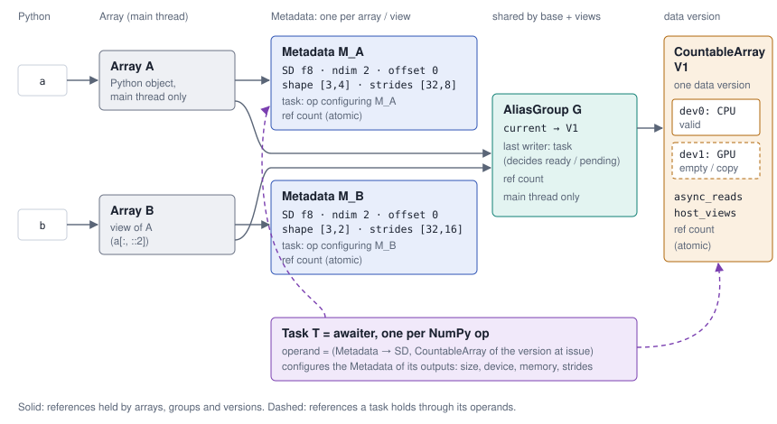

# Array data model

This document defines the data model of a viproc array: which objects make
up an array, who creates, reads, writes and releases them, and which checks
keep the data consistent while the main thread only issues ops and workers
compute them. It builds on the execution model in CLAUDE.md,
`memory-management.md` (ownership, pools, copy-on-write, NumPy interop) and
`pipelining.md` (stages, tasks advancing them).

Status labels as in `memory-management.md`: **Decided** (the design holds,
the code may still lack parts of it) and **Implemented**.

## Summary

| # | Decision | Status |
|---|----------|--------|
| A1 | An array is four objects: Array, Metadata (size descriptor + task), AliasGroup (shared by a base and its views), CountableArray (one data version, one handle per device) | Implemented |
| A2 | The size descriptor (SD) lives in its Metadata, pooled with it; operands reference it instead of copying it | Implemented |
| A3 | One task per NumPy op (the Accelerator's *awaiter*); the main thread always creates the Array and an empty Metadata, the task configures the op's outputs | Decided (pipelining S2) |
| A4 | Copy-on-write is register renaming: the AliasGroup switches to a new CountableArray; readers keep the version they captured | Implemented |
| A5 | The Array, not the Metadata, holds the AliasGroup | Implemented |
| A6 | An array is not a NumPy `ndarray` (rejected alternative) | Decided |



## A1: objects

```
Python name ──► Array A ──► Metadata M_A ── SD, Task
                   │
                   └──────► AliasGroup G ── current ──► CountableArray V ── handle[dev0], handle[dev1], …
                   ┌──────►      ▲                       (one data version)   async_reads, host_views
Python name ──► Array B ──► Metadata M_B ── SD, Task
               (view of A)

Task T ── operands: (Metadata, CountableArray captured at issue), …
```

- **Array** (A): the Python-visible object. Main thread only. Holds its
  Metadata and its AliasGroup.
- **Metadata** (M): the layout of one array or view: its size descriptor
  (SD) and the task of the op that configures it. One per array and per
  view. Created by the main thread; complete once its task reached
  *allocated*, immutable after that.
- **AliasGroup** (G): the node a base array and all its views share: the
  current data version (`current`) and the last task writing it
  (`last_writer`, which decides `ready` / `pending`). Main thread only. A
  write through any view changes only G, so the base and all other views
  see it without viproc knowing the views. In register-renaming terms G is
  the architectural register.
- **CountableArray** (V): one data version, the "memory": one handle per
  device, each empty or a valid copy of the same values (the physical
  register). `async_reads` and `host_views` live here, because readers read
  a version and all views share the version. Which device a reader uses is
  decided by its task (phase 2: cost functions); a copy to another device
  fills a handle of the *same* version and changes no values.
- **Task** (T): one per op invocation, the Accelerator's *awaiter*. Each
  operand holds the Metadata (for the SD) and the CountableArray the op was
  issued against (all device copies of that version). A task never reaches
  its data through Metadata → AliasGroup: after a copy-on-write, G points to
  a newer version, the task must still read its own.

### Implementation

| object | code | count |
|---|---|---|
| Array | `Array` (`runtime.hpp`): `MetadataPtr`, `Ref<AliasGroup>` | `Ref<T>`, plain int (main thread) |
| Metadata | `Metadata` (`task.hpp`): `Layout sd_`, `shared_ptr<Task> task_`; `make_metadata` from a per-thread pool | `MetadataPtr`, intrusive atomic |
| AliasGroup | `AliasGroup` (`runtime.hpp`): `current_`, `last_writer_`, `last_error_` | `Ref<T>`, plain int (main thread) |
| CountableArray | `CountableArray` (`countable_array.hpp`): `handles_[kDeviceCount]` (one `DeviceHandle {data, capacity}` per device; phase 1 has `kHost` only), `async_reads`, `host_views` | `shared_ptr`, atomic |
| Task | `Task` (`task.hpp`): `Operand {buffer, meta, sd, counted_read}` | `shared_ptr`, atomic |

A base array and its group share one pooled `ArrayBlock`; a view gets a
block of its own (its Array) and references the base's group. Ops that run
directly on the main thread (`Runtime::issue_direct`) create no task: their
operands point at the arrays' SDs, which outlive the call, and hold no
Metadata reference.

## A2: the size descriptor

The SD is a `Layout`: dtype, shape, byte strides, byte offset. Shape and
strides are inline vectors (rank ≤ 4 without a heap allocation), so a
Metadata from the pool costs no allocation for the common ranks.

- **Referenced, not copied, by operands.** An operand holds the Metadata
  and reads the SD through it. With pipelining a copy at issue is
  impossible anyway: an input that is only *created* has no SD yet, the
  consumer reads it after the input's stage event.
- **Strides in bytes**, as NumPy (`view(dtype)`, `real`/`imag`,
  `as_strided` give strides that are no multiple of the item size).
- **Published by stage, without a lock.** The task writes the lengths
  (*size completed*) and the strides (*allocated*) with plain stores, then
  stores the stage with `memory_order_release`; a thread that read the
  stage with `memory_order_acquire` sees the fields complete. Before
  *allocated* only the header and the lengths may be read or copied. Until
  pipelining lands, the main thread writes the whole SD at issue and
  `Metadata::task` stays null.

## A3: tasks configure their outputs

The main thread **always** creates the Array and its Metadata (empty,
stage *created*), and the AliasGroup and CountableArray of a new output
(handles empty). The task of the op does everything else on its outputs:
size, device, memory, strides, values (`pipelining.md`, S2). An in-place
write creates no new Metadata: the writing task becomes `G.last_writer`.

## Python assignments

NumPy has reference semantics and so does a viproc array: a view writes
into its base. There are no lazy-copy views as in ILNumerics; copies happen
where NumPy copies, and invisibly as copy-on-write for asynchronous readers.

| Python | semantics | effect on the data model |
|---|---|---|
| `b = a` | second name, same object | none (Python refcount of A) |
| `b = a[1:]`, `a.T`, `a.reshape(...)` as a view | reference to the same data | new Array and Metadata (own SD), G shared |
| `b = a.copy()`, `np.array(a)` | value | new Array, Metadata, G, V; a copy task reads V |
| `a = a + 1` | new result, name rebound | new objects; the old A dies, the result may take over its block (elision) |
| `a += 1`, `np.add(a, 1, out=a)` | mutation | in/out op on G; all views see the result |
| `a[k] = x` | partial mutation | see "Mutation" |
| `s = a.sum()`, then `s += 1` | value (NumPy scalars are immutable) | ready: NumPy scalar; pending: 0-d array marked `_scalar`, `+=` rebinds |

## Issuing an op: checks per argument

Notation: `M` the argument's Metadata, `G` its AliasGroup, `V = G.current`.

**Input only**
1. SD not yet at the stage the op needs? Register on that stage of
   `M.task` (pipelining).
2. `G.last_writer` pending? Register on its *completed*: the op becomes a
   continuation.
3. **Always** (pending or ready) `V.async_reads++`; the operand holds V. A
   writer issued later must also protect readers that have not started.

**In/out**
1. `G.last_writer` pending? Register on it (write after write). Then
   `G.last_writer := T`.
2. Other readers? `V.async_reads > 0`, `V.host_views > 0`, or an input of
   T reads G through another view (`a += a[::-1]`). The op's own reads are
   not counted.
3. Yes: copy-on-write. No: in place.

**New output**: Array, empty Metadata (task T), new G with an empty V. T
fills the SD, picks the device, allocates (or takes over the block of a
dying input), computes.

### A4: copy-on-write as register renaming

`G.current := V'`, a new CountableArray with empty handles. T reads V and
writes V'; older readers keep V through their operands until they finish.

- **Without a copy** when A is the only view of G, covers all of it and T
  writes every element.
- **Otherwise with a copy:** T copies V into V' right before its kernel;
  if nobody reads V any more by then, V' takes over V's block instead.
- Never attach a new AliasGroup to A: its views would stay on the old one
  and miss the write.

Example: T1 reads `a` (operand holds `(M_a, V)`, `V.async_reads == 1`);
`b = a[1:]` (new Array and Metadata, G shared); `b[0] = -1`: `async_reads > 0`
gives copy-on-write, `G.current := V'`, the write task copies V into V' and
writes -1. `a` and `b` reach their data through G and see V'; T1 reads V
through its operand and sees the old values.

## Ops that change no elements

`.T`, `swapaxes`, `reshape` as a view, basic indexing: new Array, new
Metadata, G shared. Nothing is read: no `async_reads++`, no wait on
`G.last_writer`.

- The view's SD is computed on the main thread when A is *allocated*
  (strides known), else by a task once A reaches *allocated*.
- **`reshape`:** whether NumPy returns a view or a copy depends on the
  strides, and so does whether the result shares G. The main thread must
  know that at issue, because later ops find their dependencies through G.
  So strides are predicted at issue (NumPy's layout rules are
  deterministic), even when memory comes at *allocated*; where that is
  impossible, `reshape` waits for A's *allocated*.

## Mutation (`a[key] = value`, ILNumerics' SetRange)

The target is A or a view; the procedure is the same, since everything
shared lives in G.

Checks (main thread, at issue):
1. **Read-only** target (`broadcast_to`, part of an export): NumPy's error,
   at once.
2. **Key and value:** pending viproc arrays become dependencies (callbacks,
   `async_reads++` on their versions). The value is cast to the target
   dtype. The key kind picks the kernel: basic → assign, integer arrays →
   scatter, boolean mask → masked assignment.
3. **Write after write:** `G.last_writer` pending? Register; then
   `G.last_writer := T`.
4. **Write after read:** `V.async_reads > 0` or `V.host_views > 0`?
   Copy-on-write.
5. **Overlap:** value or key read G (`a[1:] = a[:-1]`)? Copy-on-write too;
   T reads the old V.
6. **Shortcut:** everything ready, no readers, small target: NumPy's own
   slot writes on the main thread, no task.

Actions:
- **Only G changes:** `last_writer`, and `current` on copy-on-write. The
  Arrays and Metadata objects of A and all views stay as they are; their SDs
  (offsets, strides) stay valid in the new version, since copy-on-write
  keeps the layout.
- **All views become pending automatically:** readiness is read from
  `G.last_writer`, not from the Metadata.
- **Copy-on-write for a partial write always copies:** T copies the whole
  old version before its kernel, then writes its part. No copy only when
  the target is the only view, covers everything and every element is
  written (`a[...] = x`); scatter and masks never write everything.
- **Run-time errors** (index out of bounds) are reported asynchronously
  (`error-handling.md`); G keeps the error, also after a later overwrite.

## Lifecycle

Everything is created by the main thread when it issues an op. Workers
create nothing; they fill in (SD, memory, values) and release. What a
worker may release has an atomic count; what only the main thread touches
has a plain one.

| part | created | access | held by | released: who, when |
|---|---|---|---|---|
| Array A | main thread, at issue: op output, view, import, creation function | main thread only (Python object, GIL) | Python names and containers | main thread, when the Python refcount reaches 0; drops S and G |
| Metadata M | main thread, with A, empty (*created*), from the pool; SD fixed to it | write: T in stage order (lengths at *size completed*, strides at *allocated*), the main thread where it knows the SD at issue; read: main thread and tasks holding S as an operand, after the stage signal | A; task operands (inputs and outputs); S holds its task until *completed* | any thread, with the last reference (atomic): A is dead and no operand holds S; back to the pool |
| AliasGroup G | main thread, with the base array (output, import, copy); views share it | main thread only: sets and reads `current`, `last_writer` (whether the task completed: its atomic state) | A and all its views (Arrays, not Metadata objects) | main thread, when the last array of the group dies; drops `current` and `last_writer` (the latter as soon as it sees it completed) |
| CountableArray V | main thread, for a new output or on copy-on-write; handles empty | handles: the writing task allocates right before its kernel, device copies fill further handles (atomic slots), on the task's thread; `async_reads`: main thread ++, reading task −−; `host_views`: main thread | G (`current`), operands of reading and writing tasks, NumPy exports | any thread, with the last reference (atomic): G points to a newer version or is dead, and no operand or export holds V; device memory to that device's pool, foreign memory (imported ndarray) through the main thread |
| Task T | main thread, at issue, one per op, from the pool (the direct path for small ready data creates none) | main thread: issue, callback registration, waits at sync points; workers (or the main thread inline): advance stages, run the kernel | callbacks of its inputs (as consumer), the Metadata objects of its outputs, G as `last_writer`, the thread running it | any thread, with the last reference; on *completed* T releases its operands (`async_reads` −−) and callbacks, S and G drop T once they see it completed; back to the pool |

**Cycles.** M ↔ T (T holds M as an output, M holds T as its task) breaks
on *completed*: T drops all its operands, outputs included, so nothing is
leaked even while M still holds T. `M.task` is a strong reference and is
read and written by the main thread only (like `G.last_writer`): it
registers on T's stages through it and drops T once it sees T completed,
at the latest when M dies. Workers learn about stages through callbacks
and never read `M.task`. So a weak or raw pointer is not needed.

### A5: the Array holds the AliasGroup

A Metadata can die on a worker (the last reference from an operand). If it
held G, a task's operand would keep G alive, and with it `G.current` = V,
after A died: V would always have one reference more than the task's, and
the task could never take over a dying input's block (run-time elision,
`memory-management.md` D11). G would also need an atomic count although no
worker needs G. An atomic count is not free: an uncontended `lock xadd` is a
full barrier on x86 (~5-10 ns), and a count that both the main thread and a
worker change moves its cache line between cores (~40-100 ns per transfer
on one socket, read-for-ownership under MESI), on the main thread, which
issues every op and is the bottleneck. So A holds M and G, G stays a
main-thread object, and atomic counts stay on M, V and T, which workers do
release.

## Sync points

- Values (`print`, `float`, export): wait for *completed* of
  `G.last_writer`.
- Metadata (`shape`): wait for *size completed* of `M.task`.

## A6: rejected alternative, an array as a NumPy `ndarray` plus a task

Each of these rules it out:

1. An `ndarray` needs a shape, strides and a data pointer when it is
   created: no stage *created* (pipelining S1/S4), and element memory
   taken at issue on the main thread (D10, superseded because dependent
   chains got 2-4x slower than NumPy).
2. Workers cannot touch it: its references are Python refcounts (GIL).
3. NumPy views have their own data pointers; copy-on-write would have to
   find and patch every view. Readiness, producer and `async_reads` need a
   shared node anyway.
4. Handing the `ndarray` to the user is not effortless but unsafe: NumPy
   calls on it bypass viproc and race with the workers (D7, and the
   decision against an `ndarray` subclass, D9).
5. One host pointer, no device copies.

Handing data to NumPy is copy-free already (D7: read-only exports counted
as readers, adoption of fresh memory). NumPy's custom allocator (NEP 49,
`PyDataMem_SetHandler`) would only let NumPy allocate fallback results from
viproc's element pool; it is set per context and applies to every NumPy
allocation there, so it would have to be set around viproc's own fallback
calls only. Not needed for this model.

## Evaluation: how the model was chosen

Two models were compared: **(A)** size descriptor + storage + task and
**(B)** an array that is a NumPy `ndarray` plus a task. B is ruled out by
A6. A was refined in four steps.

**1. The ILNumerics size descriptor.** ILNumerics (`ILNumerics.ONAL`,
`StorageLayer/Size/Size.cs`) keeps one flat `long[3 + 2·32]` per Storage:
`ndim`, element count, base offset, then all lengths, then all strides (in
elements), pooled with its Storage and overwritten on reuse. Element memory
is separate: a refcounted `CountableArray` of `MemoryHandle`s, one per
device, shared by views. viproc takes the idea (SD fixed to a pooled
object, referenced by tasks, published by stage), with three differences:

- Strides stay in **bytes**, as NumPy's (A2).
- The SD is a `Layout` with inline vectors, not a flat block of NumPy's
  maximum rank (64 dimensions, ~1 KB per block). A flat block would save
  one length field per vector and a stored element count, worth a few
  dozen instructions per op at most; it is a separate change, worth making
  only if callgrind shows the gain (G3).
- Tasks reference the SD instead of copying it: required by pipelining S2,
  where an input's SD does not exist yet at issue.

**2. One object per data version.** The first refinement put the SD, the
task and the CountableArray into one object per data version (then called
"Storage", after ILNumerics), immutable once a task holds it,
so a reader keeps the version of its issue time. That works for ILNumerics'
value semantics, where a sub-array is a lazy copy. NumPy has reference
semantics: `b = a[::2]; b[0] = 1` changes `a`. Base and views therefore
need a shared node holding the current version and the last writer, so a
write through one view makes all others pending and copy-on-write switches
all of them together, without viproc knowing the views: the AliasGroup.

**3. A flag instead of the AliasGroup does not work.** "NumPy mode: do not
copy on write" removes neither need. Copy-on-write is not for value
semantics but for readers still running (`y = a + 1` pending, then
`a += 1`); without it the writer would have to wait for all readers, an
event that does not exist (arrays do not know their readers). And without
a copy the order is still missing: after `b[0] = 1`, `a.sum()` must wait
for that write, so `a` must find `b`'s last writer.

**4. Who holds what.** The task is the awaiter of exactly one op; the main
thread creates every Array and (empty) Metadata (A3). Operands capture
(Metadata, CountableArray), never the AliasGroup, so copy-on-write is plain
register renaming (A4). The Array, not the Metadata, holds the AliasGroup,
so a dying Array releases the current version and the next op can take
over its block (A5). Device handles sit in the CountableArray, not the
Metadata: a reader captured a version, and a handle added later belongs to
that same version.

**Follow-ups, each measured on its own (G3):** stage-wise SD publication
and `Metadata::task` with pipelining S2/S4; further device handles with the
first non-CPU device (phase 2); a flat SD block if callgrind shows a gain;
a NEP 49 allocator for large fallback results if measurements call for it.

**Naming.** The object holding the SD and its task was first called
Storage, after ILNumerics; it holds no data, so it is called Metadata.
